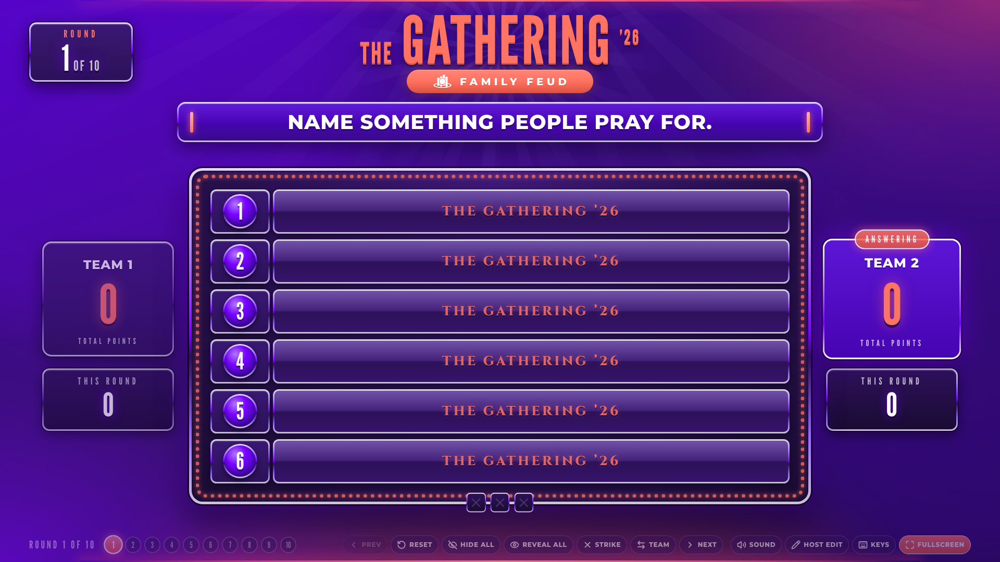

# ICGC Gathering Edition — Family Feud

A Family Feud–style game show board made for the ICGC church gathering. It runs on a laptop and is meant to be shown on a projector or large screen. You don't need the internet once it's set up.



---

## How the game works

### What the audience sees

- The **ICGC Gathering Edition** title at the top, with the **round number** on the left.
- The **question** for the round in a banner across the screen.
- A board with **six numbered answer slots**. Answers stay hidden until the host reveals them.
- When the host reveals an answer, the slot **flips over** with a chime and shows the answer and how many people voted for it. Those votes are added to the score of the team that is answering.
- A **team card** on each side of the board shows that team's **total points**, with a smaller **This round** card underneath showing what the team has earned in the current round. The team that is currently answering glows and has an **Answering** tag.

There are **10 rounds**, each with its own question.

### What the host does

The host runs the game from the laptop, using the mouse or the keyboard.

- **Choose which team is answering:** click that team's panel, press **T**, or click **Team** to switch.
- **Reveal an answer:** click its slot, or press its number (**1–6**). Answers can be revealed in any order. The answer's votes go to the team that is answering. Clicking a revealed answer hides it again and takes those points back.
- **Reveal the next hidden answer:** press **Space**.
- **Wrong answer:** press **X** (or click **Strike**) to flash a big red ✕ with a buzzer. Each round keeps track of up to 3 strikes, shown under the board.
- **Change rounds:** use the **← / →** arrow keys, the **Prev / Next** buttons, or click a numbered dot at the bottom left.
- **Fullscreen:** press **F** or click **Fullscreen**. Press **F** or **Esc** to leave fullscreen.

The buttons along the bottom stay faded so they don't distract the audience. Move the mouse over them to make them easier to see.

### All keyboard shortcuts

| Key | What it does |
| --- | --- |
| **← / →** | Previous / next round |
| **1 – 6** | Reveal that answer |
| **Space** | Reveal the next hidden answer |
| **A** | Reveal all answers |
| **H** | Hide all answers |
| **R** | Reset the round (hides answers and clears strikes) |
| **X** | Add a strike |
| **T** | Switch which team is answering |
| **F** | Fullscreen on/off |
| **E** | Open/close Host Edit mode |
| **M** | Sound on/off |
| **?** | Show the shortcut list on screen |

### Entering the real vote counts (Host Edit mode)

Votes are collected separately (for example with Mentimeter). To enter the results:

1. Go to the round you want to update.
2. Press **E** or click the **pencil (Host Edit)** button. A panel slides in from the right.
3. Type in the question, the answers, and the number of votes for each one.
4. Press **E** again or click the **✕** to close the panel.

Your changes **save automatically**. Refreshing the page or closing the browser won't lose them, as long as you use the **same browser on the same computer**.

- **Restore this round** puts the current round back to its original questions and votes.
- **Restore all defaults** does the same for all 10 rounds.

The **Teams** section of the panel lets you rename each team and type in a team's total points if you need to correct it. **Reset team scores** sets both teams back to 0 for a new game.

> **Tip:** Host Edit mode is visible on screen, so enter the results before the projector is on, or while the screen is turned away from the audience. Or use the phone host page below, which the audience never sees.

### Running the game from your phone (Host Mode)

The host can control the game from a phone while the laptop shows the board on the projector. The phone shows every answer and vote count, so you can see what's coming without the audience seeing it. No internet or accounts are needed, but **the phone and laptop must be on the same Wi-Fi**.

1. On the laptop, start the game with `npm run host` instead of `npm run dev`. The terminal shows two addresses, for example:
   ```
   Local:   http://localhost:5173/
   Network: http://192.168.1.23:5173/
   ```
   If the Mac asks whether to allow incoming connections, click **Allow**.
2. On the laptop, open the **Local** address in Chrome, press **F** for fullscreen, and click the page once (browsers only play sound after you've clicked the page).
3. On the phone, open the **Network** address with `?view=host` added to the end, for example `http://192.168.1.23:5173/?view=host`. The banner should say **Connected**.

On the phone you can:

- Tap a team to make it the answering team.
- Tap an answer to reveal it on the projector (its votes go to the answering team). Tap it again to hide it.
- Strike, Switch team, Reveal all, Hide all, Reset round, Sound on/off, and change rounds with the arrows.
- Use **Edit votes & teams** to type in the Mentimeter results, team names, and team totals.

Everything you do on either device shows up on the other straight away. The laptop's keyboard and mouse controls keep working too, so if the phone has a problem, just carry on from the laptop.

**If the phone won't connect:**

- Some church or guest Wi-Fi networks block devices from talking to each other. Turn on your phone's **Personal Hotspot**, connect the laptop to it, restart `npm run host`, and use the new Network address.
- Check the laptop hasn't gone to sleep, and that the terminal running `npm run host` is still open.
- If the banner says **Reconnecting…**, wait a few seconds; it catches up automatically.

> Don't edit the code files while the game is running: the pages reload when a file changes.
>
> The shared game state is also saved in a `.feud-sync.json` file in the game folder, so stopping and restarting `npm run host` keeps everything. To start completely fresh, stop the game, delete that file, and use **Restore all defaults** and **Reset team scores**.

---

## Getting it onto your computer

You only need to do this once per computer.

### 1. Install Node.js

The game uses a free program called **Node.js** to run.

1. Go to [nodejs.org](https://nodejs.org/).
2. Download the **LTS** version (version 22 or newer) and install it with the default options.

### 2. Download the game from GitHub

Pick **one** of these options.

**Option A — Download a ZIP (easiest)**

1. Open the project's GitHub page in your browser.
2. Click the green **Code** button, then click **Download ZIP**.
3. Find the ZIP in your Downloads folder and double-click it to unzip it.
4. Move the unzipped folder somewhere easy to find, such as your Desktop or Documents.

**Option B — Use Git (if you already have it)**

```bash
git clone https://github.com/<your-username>/<repo-name>.git
```

Replace the address with the one shown under the green **Code** button on the GitHub page.

### 3. Open a terminal in the game folder

- **Mac:** Open the **Terminal** app. Type `cd ` (with a space after it), drag the `church-family-feud` folder into the Terminal window, and press **Enter**.
- **Windows:** Open the `church-family-feud` folder in File Explorer, click the address bar at the top, type `cmd`, and press **Enter**.

> If you downloaded the whole project, the `church-family-feud` folder may be inside another folder. Open the folder that contains the `package.json` file.

### 4. Install the game's parts (first time only)

Type this and press **Enter**:

```bash
npm install
```

Wait for it to finish. It may take a minute.

### 5. Start the game

Type this and press **Enter**:

```bash
npm run dev
```

You'll see an address like `http://localhost:5173/`. Open that address in **Google Chrome** (recommended), then press **F** for fullscreen.

To stop the game, go back to the terminal window and press **Ctrl + C**.

**Next time**, you only need to repeat **step 3** (open a terminal in the folder) and **step 5** (`npm run dev`).

---

## Before the event: a quick checklist

- [ ] Start the game and open it in Chrome on the laptop you'll actually use.
- [ ] Enter the vote counts in Host Edit mode **in that same browser**.
- [ ] Connect the projector and press **F** for fullscreen.
- [ ] Turn up the laptop volume (or connect speakers) if you want the sounds.
- [ ] Press **R** on any round you tested so it starts out hidden.
- [ ] Enter the team names and click **Reset team scores** in Host Edit mode so both teams start at 0.
- [ ] If you're hosting from a phone: at the venue, run `npm run host`, open the host page on the phone, and check that revealing an answer on the phone shows up on the projector.
- [ ] Turn off laptop sleep and keep the laptop plugged in.

### Projector tips

The game always draws a 16:9 board and scales it to fit the screen, so it looks the same on any laptop or projector. On a 4:3 projector you'll see a little extra background above and below the board.

- **Keep the browser zoom at 100%.** Press **Cmd + 0** (Mac) or **Ctrl + 0** (Windows) to reset it. Zooming in or out shrinks or enlarges everything.
- **Use the projector's own resolution.** On a Mac, open **System Settings → Displays**, select the projector, and choose its default resolution (usually 1920 × 1080 or 1280 × 720).
- **Mirror or extend:** mirroring shows the same screen on both. Extending lets you drag the game window onto the projector and keep the laptop screen for yourself. Either works; press **F** after the window is on the projector.
- **If the edges are cut off on the wall,** the projector is cropping the picture ("overscan"). Turn off overscan in the projector's menu, or on a Mac turn on **Underscan** in the display settings.

---

## For developers

- Built with React, Vite, and plain CSS. The icons come from `lucide-react`.
- The default questions are in [`src/data/rounds.js`](src/data/rounds.js).
- [`src/README.md`](src/README.md) describes the code structure.
- `npm run build` creates a production build in `dist/`, and `npm run lint` checks the code.
